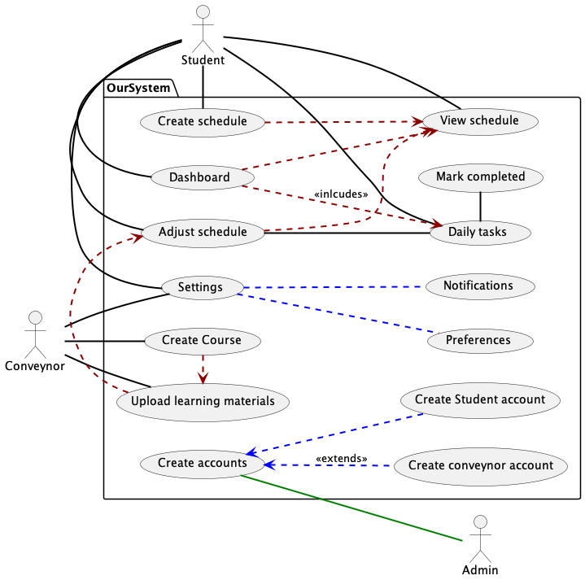

<div align="center">

# Study Scheduler

**Requirements, use cases and UML design for a student study-planning system.**

CO1106 Software Engineering · Group 36 · University of Leicester


[Functional requirements](functional-requirements.md) · [Use cases](UseCaseDesc.md) · [Class diagram](Class_Diagram.pdf) · [Weekly log](WeeklyLog.md)

</div>

## Overview

Study Scheduler is a design proposal for an application that builds a realistic study plan around a student's timetable, deadlines and personal constraints. The plan adapts when tasks are missed, sends reminders through the student's preferred channel, and gives them a single view of what to do next.

This repository contains the analysis and design deliverables for the project. It is not a runnable application.

## The problem

Students often manage module schedules, coursework deadlines and revision in separate places. A static timetable does not account for a missed session, a new deadline or the difference between a one-hour gap and a free afternoon. The proposed system treats study time as something that should be planned, tracked and adjusted, rather than a list of intentions.

## Proposed capabilities

- Generate an initial study schedule from module information, including lectures, tutorials, seminars, labs and exams.
- Present the plan as a timeline and a daily task list.
- Let students adjust study sessions manually and mark tasks complete.
- Reschedule automatically when a daily task is missed.
- Send reminders by email, SMS, push notification or a combination of channels.
- Support configurable reminder timing before events and study sessions.
- Include a built-in Pomodoro timer.
- Show progress through a dashboard with charts and performance colours.
- Include a grade calculator that highlights assessments with the highest weight.
- Respect personal constraints such as meal times, two free evenings per week and a weekend-study preference.

The full requirement set is in [functional-requirements.md](functional-requirements.md).

## Design artefacts

| Artefact | What it covers |
|---|---|
| [Functional requirements](functional-requirements.md) | The system's required behaviour, constraints and user expectations |
| [Use case diagram](Use-Case-Image.png) | Actors and the main interactions with the system |
| [Use case descriptions](UseCaseDesc.md) | Preconditions, typical flows and alternative flows for each use case |
| [Class diagram](Class_Diagram.pdf) | The proposed object model and relationships |
| [PlantUML source](UML-Source) | Editable source for the UML diagrams |
| [Weekly log](WeeklyLog.md) | Group progress and individual contributions |
| [Self-assessment](CO1106_self_assessment_form_Group36.docx) | Group reflection and contribution record |

## Use case model

<p align="center">
  
</p>

The model covers account creation, schedule creation, daily task completion, notifications, manual schedule changes, progress tracking and grade calculation.

## Class model

The proposed class model is available as a [PDF](Class_Diagram.pdf). The editable PlantUML source is in [`UML-Source/Class_Diagram.pu`](UML-Source/Class_Diagram.pu).

## Repository layout

```text
Study-Scheduler/
├─ functional-requirements.md          Requirements and constraints
├─ UseCaseDesc.md                      Written use case descriptions
├─ Use-Case-Image.png / .jpg           Use case diagram
├─ Class_Diagram.pdf                   Class diagram
├─ UML-Source/                         PlantUML source files
├─ WeeklyLog.md                        Weekly group and individual log
├─ CO1106_self_assessment_form...docx  Group self-assessment
└─ Group36-SHA1.txt                    Submission checksum
```

## Team

Group 36:

- James Carr
- Jaysinh Maher
- Lukas Hammer
- Jan W Makarewicz
- Youssef Sadquy
- Kalam Hakim

## Academic context

This work was produced for CO1106 Software Engineering at the University of Leicester. It is shared as a portfolio example of requirements analysis, use case modelling and object-oriented design. The repository does not include an implementation, and the documents should not be presented as a shipped product.
